# lemy0715

AI와 함께 서비스와 게임을 기획·개발·배포·운영합니다. 대부분 1인 작업이며, 한 일을 사실 위주로 적었습니다.

- 포트폴리오: https://lemy0715.mycsbot.com/
- 이메일: lemy0715@gmail.com

<!-- summary:start -->
| 내세우는 것 | 근거 | 바로 보기 |
|---|---|---|
| **끝까지 내놓고 운영한다** | 22개 중 운영 중 15 · 스토어 출시 게임 7 | [프로젝트](#프로젝트) |
| **반복을 시스템으로 바꾼다** | 게임 공통 킷·검증 도구 · OpenAPI→MCP 도구 자동 생성 · 커밋 고정 배포·롤백 | [만드는 방식](#만드는-방식) |
| **AI에게 맡기되 판단은 내가 한다** | 목표·요구사항·검증은 제가, 코드는 주로 AI가 · 품질이 안 나온 AiMER는 직접 종료 | [AI와 일하는 방식](#ai와-일하는-방식) |
| **운영까지 책임진다** | 모든 서비스 지표를 중앙 Prometheus·Grafana로 수집 · 이전 직장에서 EKS 12개 관측성 전환 | [이전 경력](#이전-경력) |

**최근 작업**

- 2026-11-01 · 틀린그림찾기 — AI 이미지 생성 파이프라인으로 그림 100단계 제작
- 2026-10-30 · 브릭 스톰 — 한 손가락 조준·발사 벽돌깨기, 스토어판 86개 언어
- 2026-10-28 · UMMA 배달 주문 서비스 — 사용자 앱·배달기사 앱·관리자 웹·백엔드 외주 개발 (알파 테스트 중, 화면 비공개)
- 2026-10-27 · 사천성 — 꺾인 선 3번 규칙 짝맞추기, 단계마다 판 확장·경로 시각화
- 2026-10-27 · 보석 맞추기 — 1,200단계 매치3, 목표 7종을 단계 생성기로 생성
<!-- summary:end -->

## AI와 일하는 방식

> AI는 유능한 동료이자 비서입니다. 하지만 만능은 아닙니다.
> 결과의 쓸모와 효율은 무엇을 원하는지, 즉 목적과 요구사항을 얼마나 분명히 전하느냐에 달려 있습니다.
> 그래서 AI의 강점과 한계, 일을 맡기고 피드백하는 방식을 익혀 한 명의 코워커처럼 함께 일하려 합니다.
> 목표를 정하고 결과를 판단하는 것은 제 몫이고, 그렇게 아낀 시간으로 더 많은 것을 만듭니다.

## 만드는 방식

- **반복되는 일은 도구로 만듭니다.** 게임은 공통 킷·플랫폼 어댑터 위에서 만들고, 게임 검증 도구·이미지 제작 흐름·빌드·업로드 자동화를 함께 씁니다.
- **API는 처음부터 AI가 쓰게 만듭니다.** API 전체를 MCP 도구로 제공해 대화형 AI에서 바로 씁니다(Simsim은 OpenAPI에서 도구를 자동 생성).
- **배포는 되돌릴 수 있게 합니다.** 커밋(SHA) 고정 릴리스·롤백, 서비스 지표는 중앙 Prometheus·Grafana로 모읍니다.
- **멈출 때는 이유를 남깁니다.** 종료한 프로젝트도 지우지 않고 사유와 함께 둡니다.

## 프로젝트

<!-- projects:start -->
> 총 22개 · 🟢 운영 중 15 · 🟡 개발 중 4 · ⚪ 미운영 3

### 서비스 · AI · 인프라

| 분야 | 프로젝트 | 한 줄 소개 | 상태 | 최근 갱신 |
|---|---|---|---|---|
| AI · MCP | **Simsim AI 비서** | 영수증 추출·기관 양식 문서 작성을 돕는 AI 비서와 원격 MCP 서버 | 🟢 운영 중 | 2026-07 |
| AI · MCP | **dolemy** | 일상으로 반복하는 일과 운영 업무를 지원하는 어시스턴트 AI 비서 | 🟢 운영 중 | - |
| Gridmint 트레이딩 | **Gridmint Bots** | 그리드봇·시그널봇·스캘퍼를 한 콘솔에서 생성·정지·관리 | 🟢 운영 중 | 2026-10-17 |
| Gridmint 트레이딩 | **Gridmint Ledger** | 여러 거래소의 자산·수익·거래 내역을 모아 KRW·USDT 구분 표시 | 🟢 운영 중 | 2026-09-23 |
| 서비스 · 도구 | **Ablog (autoblog)** | Google Docs 원고를 WordPress·네이버 카페·네이버 블로그에 자동 게시 | 🟢 운영 중 | 2026-10-18 |
| 서비스 · 도구 | **[A4 Workshop](https://muyoul.github.io/a4workshop/)** | 한글 쓰기 연습용 A4 학습지 생성기 | 🟢 운영 중 | 2026-08-15 |
| 인프라 · 운영 | **lemy0715-observability** | 모든 서비스의 지표를 모으는 중앙 Prometheus·Grafana 플랫폼 | 🟢 운영 중 | 2026-10-17 |
| 서비스 · 도구 | **UMMA 배달 주문 서비스** | 사용자 앱·배달기사 앱·관리자 웹·백엔드 외주 개발 (알파 테스트 중, 화면 비공개) | 🟡 개발 중 | 2026-10-28 |

<b>Simsim AI 비서</b> — 영수증 추출·기관 양식 문서 작성을 돕는 AI 비서와 원격 MCP 서버

- **왜**: 정부 지원사업 신청에 필요한 영수증·서류 정리를 손으로 반복하지 않으려고
- **역할**: 기능·처리 순서 결정과 실사용 검증은 본인, 데이터 구조·MCP 연결은 AI와 설계, 코드는 주로 AI
- Google 로그인 + OAuth 원격 MCP 서버
- OpenAPI에서 MCP 도구를 자동 생성해 API 전체를 AI에 제공
- 메모·이미지·Drive·RAG API, Slack 등 대화 환경에서 사용
- 기술: Python · FastAPI · React · OAuth · MCP

<b>dolemy</b> — 일상으로 반복하는 일과 운영 업무를 지원하는 어시스턴트 AI 비서

- **왜**: AI 에이전트 자동화로 어디까지 할 수 있는지 시험하려고
- **역할**: 기획·요구사항·검수는 본인, 코드는 주로 AI
- Ablog와 연동해 블로그 글 자동 발행 중
- 게임 마케팅·홍보 자동화 기획 중

<b>Gridmint Bots</b> — 그리드봇·시그널봇·스캘퍼를 한 콘솔에서 생성·정지·관리

- **왜**: 거래소마다 흩어진 포지션을 한곳에서 보고, 최종 판단은 사람이 하는 보조 도구가 필요해서
- **역할**: 설계·화면·요구사항·테스트 관리는 본인, 코드는 AI, 실사용 중 문제는 AI와 함께 수정
- 거래소 잔고를 포지션 단위로 나눠 담당 봇을 추적
- 커밋(SHA) 고정 릴리스·롤백, Prometheus/Grafana 관측
- 연동 거래소 Upbit · Coinone · Bitget · OKX
- 기술: Python · FastAPI · PostgreSQL · React · TypeScript

<table><tr>
<td width="50%">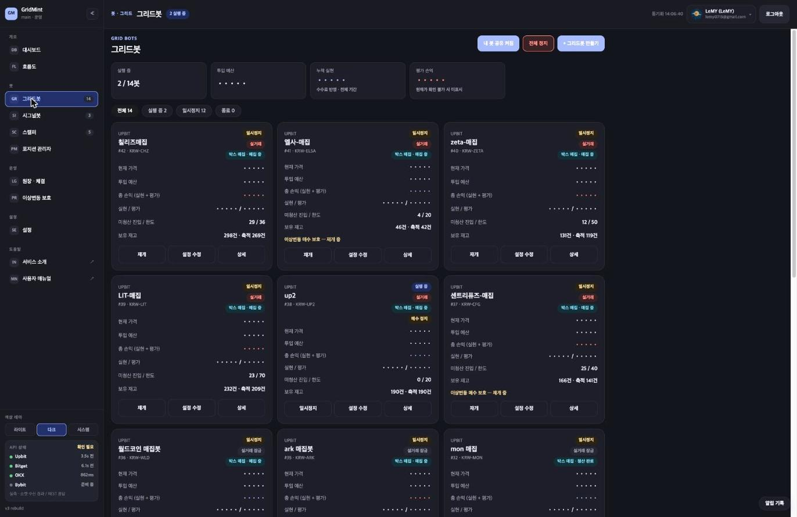 그리드봇 — 봇별 상태·예산·손익·미청산 한도</td>
<td width="50%">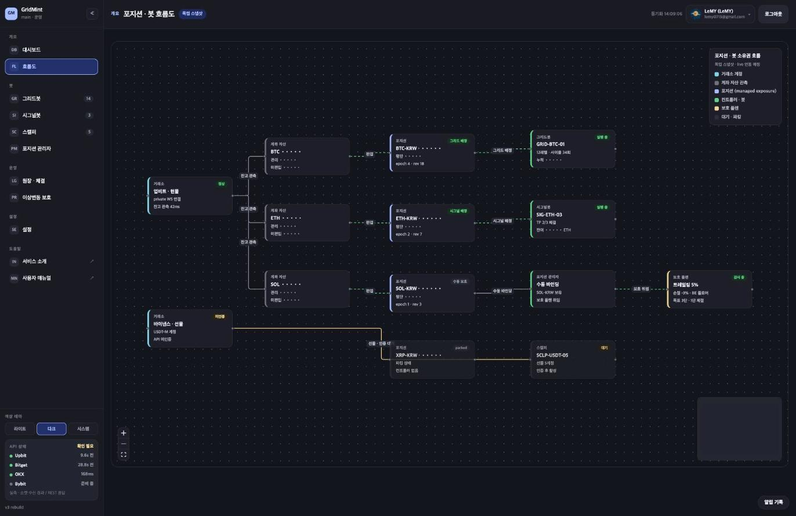 흐름도 — 거래소 잔고 → 포지션 → 담당 봇 소유권</td>
</tr><tr>
<td width="50%">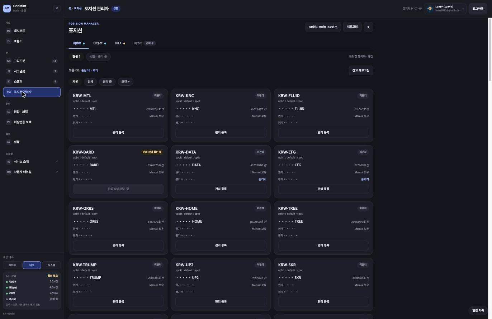 포지션 관리자 — 거래소별 보유 자산을 봇에 편입·보호</td>
<td width="50%">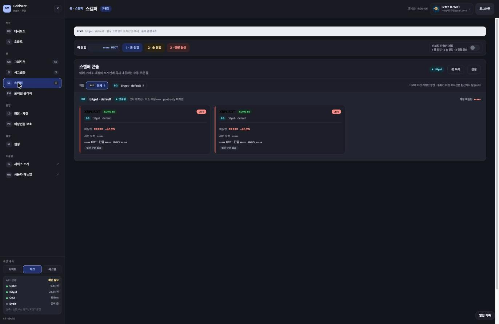 스캘퍼 — 선물 포지션 수동 진입·청산 콘솔</td>
</tr></table>

<b>Gridmint Ledger</b> — 여러 거래소의 자산·수익·거래 내역을 모아 KRW·USDT 구분 표시

- **왜**: 거래소마다 따로 접속하지 않고 전체 자산과 손익을 한 번에 보려고
- **역할**: 설계·화면·요구사항·테스트 관리는 본인, 코드는 AI
- 거래소 통합 자산·손익 조회
- 백엔드 API를 MCP로 제공해 AI로 필요한 뷰를 만들도록 설계
- 기술: Next.js · React · Python · FastAPI · MCP

<table><tr>
<td width="50%">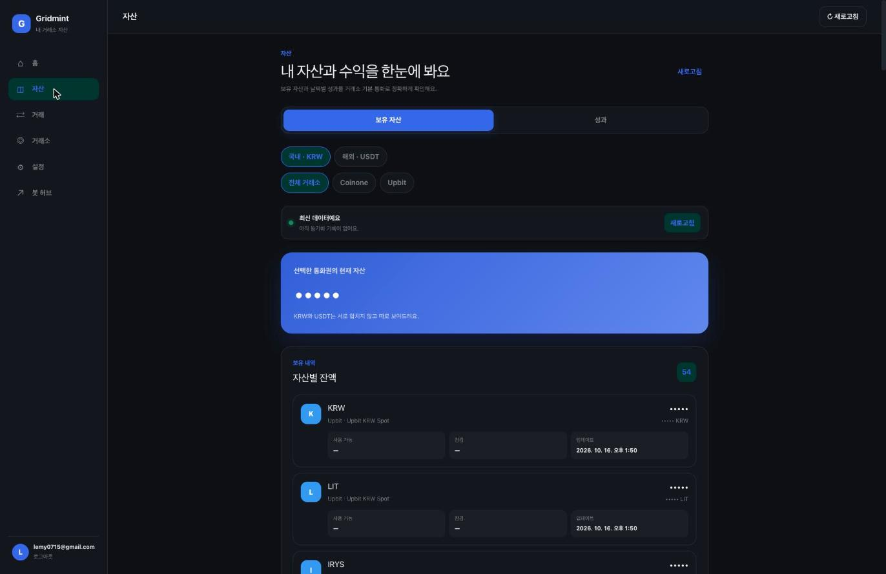 거래소 통합 자산</td>
</tr></table>

<b>Ablog (autoblog)</b> — Google Docs 원고를 WordPress·네이버 카페·네이버 블로그에 자동 게시

- **왜**: 블로그 부업을 하는 주변 사람들을 돕고자
- **역할**: 기획·요구사항·검수는 본인, 코드는 주로 AI
- Docs 인라인 이미지를 순서대로 올려 본문에 그대로 배치
- Instagram·Threads용 파생 글 생성·편집
- 기술: Python · Google Docs API · WordPress REST API

<b>A4 Workshop</b> — 한글 쓰기 연습용 A4 학습지 생성기

- **왜**: 아이의 한글 따라쓰기 연습지를 만들려고
- **역할**: 기획·요구사항·검수는 본인, 코드는 주로 AI
- 기술: HTML · JavaScript
- 웹: https://muyoul.github.io/a4workshop/

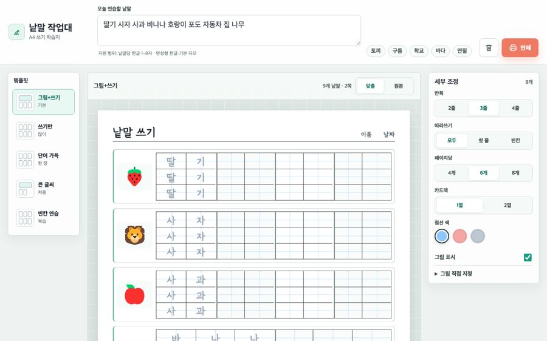

<b>lemy0715-observability</b> — 모든 서비스의 지표를 모으는 중앙 Prometheus·Grafana 플랫폼

- 각 서비스는 Alloy 수집기로 remote-write, 플랫폼은 이 저장소가 관리
- 기술: Prometheus · Grafana · Docker Compose

<b>UMMA 배달 주문 서비스</b> — 사용자 앱·배달기사 앱·관리자 웹·백엔드 외주 개발 (알파 테스트 중, 화면 비공개)

- **왜**: 발주처 의뢰 — 이동 중인 배달 트럭이 실시간으로 주문을 받아 만날 장소로 가는 서비스
- **역할**: 전체 구조·주문 흐름 설계는 본인, 초기 코드도 직접 작성했고 이후 코드는 주로 AI·본인은 요구사항·검수
- Flutter 사용자·배달기사 앱, 관제용 관리자 웹
- 결제·지도 연동, Docker Compose + Cloudflare Tunnel 배포
- 기술: Flutter · Dart · Python · Docker Compose · Cloudflare Tunnel

⚪ 미운영 3개 보기

| 분야 | 프로젝트 | 한 줄 소개 | 상태 | 최근 갱신 |
|---|---|---|---|---|
| AI · MCP | **AiMER** | 샘플 데이터로 병명 후보를 추천해 병리 보고서를 만드는 실험 | ⚪ 미운영 | 2026-07-23 |
| Gridmint 트레이딩 | **Candle Collector** | Binance·Bitget·OKX 1분봉 수집과 OHLC API·MCP 서버 (2026-09 종료) | ⚪ 미운영 | 2026-09-19 |
| 서비스 · 도구 | **슬기로운 AI 공방** | 멤버 실습·발표·출석·운영 현황을 한곳에서 관리하는 플랫폼 (운영 중지) | ⚪ 미운영 | 2026-10-28 |

<b>AiMER</b> — 샘플 데이터로 병명 후보를 추천해 병리 보고서를 만드는 실험

- **왜**: 병리의사가 채팅으로 데이터를 넣으면 보고서 초안이 나오게 하려고
- **역할**: 전체 로직·설계 방향은 본인(판단 기준은 의사와 상의), 코드는 주로 AI, 결과 검토 후 종료 결정
- 샘플 입력·보고서 생성 API를 MCP로 제공
- 협업 의사의 채팅에 연결해 사이트 없이 보고서 생성
- 테스트 검토 후 품질·비용 문제로 종료 (실제 의료 업무 미사용)
- 기술: TypeScript · Express · Prisma · Next.js · MCP

<b>Candle Collector</b> — Binance·Bitget·OKX 1분봉 수집과 OHLC API·MCP 서버 (2026-09 종료)

- **왜**: Gridmint에서 쓸 시세 데이터를 직접 모으려고
- **역할**: 기획·요구사항·검수는 본인, 코드는 주로 AI
- 기술: TypeScript · SQLite · MCP

<b>슬기로운 AI 공방</b> — 멤버 실습·발표·출석·운영 현황을 한곳에서 관리하는 플랫폼 (운영 중지)

- 멤버 웹·운영진 웹(Next.js 정적) + FastAPI 백엔드
- Terraform으로 CloudFront·S3·인증서, GitHub Actions 배포
- 이용이 없어 운영 중지
- 기술: Next.js · FastAPI · SQLAlchemy · Terraform · GitHub Actions

### 게임

| 프로젝트 | 한 줄 소개 | 상태 | 스토어 | 최근 갱신 |
|---|---|---|---|---|
| **[틀린그림찾기](https://spot-diff.mycsbot.com/)** | AI 이미지 생성 파이프라인으로 그림 100단계 제작 | 🟢 운영 중 | [Google Play](https://play.google.com/store/apps/details?id=com.mycsbot.spotdiff) | 2026-11-01 |
| **[브릭 스톰](https://brick-storm.mycsbot.com/)** | 한 손가락 조준·발사 벽돌깨기, 스토어판 86개 언어 | 🟢 운영 중 | [Google Play](https://play.google.com/store/apps/details?id=com.mycsbot.brickstorm) | 2026-10-30 |
| **[사천성](https://sacheonseong.mycsbot.com/)** | 꺾인 선 3번 규칙 짝맞추기, 단계마다 판 확장·경로 시각화 | 🟢 운영 중 | [Google Play](https://play.google.com/store/apps/details?id=com.mycsbot.sacheonseong) · [App Store](https://apps.apple.com/kr/app/id6821350907) | 2026-10-27 |
| **[보석 맞추기](https://jewel-match.mycsbot.com/)** | 1,200단계 매치3, 목표 7종을 단계 생성기로 생성 | 🟢 운영 중 | [Google Play](https://play.google.com/store/apps/details?id=com.mycsbot.jewelmatch) | 2026-10-27 |
| **[폴짝 러너](https://hop-run.mycsbot.com/)** | 원터치 러너 | 🟢 운영 중 | [Google Play](https://play.google.com/store/apps/details?id=com.mycsbot.hoprun) | 2026-10-27 |
| **[왼쪽 오른쪽](https://left-right.mycsbot.com/)** | 봄나물은 밥상, 봄꽃은 꽃병으로 나누는 1분 좌우 나누기 | 🟢 운영 중 | [Google Play](https://play.google.com/store/apps/details?id=com.mycsbot.leftright) | 2026-10-06 |
| **[두더지 잡기](https://mole-catch.mycsbot.com/)** | 60초 아케이드 | 🟢 운영 중 | [Google Play](https://play.google.com/store/apps/details?id=com.mycsbot.molecatch) | 2026-10-06 |
| **[카드 뒤집기](https://card-flip.mycsbot.com/)** | 기억력 짝 맞추기 | 🟢 운영 중 | - | 2026-10-06 |
| **[워터 레스큐](https://water-rescue.mycsbot.com/)** | 관을 돌리고 옮겨 물길을 잇는 현장 출동 퍼즐 | 🟡 개발 중 | - | 2026-10-27 |
| **[Farm Rush](https://farm-rush.mycsbot.com/)** | 터치로 즐기는 오리지널 농장 경영 게임, 1,000 스테이지 | 🟡 개발 중 | - | 2026-10-21 |
| **Abyss Relay** | 전력을 배분하며 3분을 버티는 절차 생성 잠수함 생존 게임 | 🟡 개발 중 | - | 2026-09-25 |

<b>틀린그림찾기</b> — AI 이미지 생성 파이프라인으로 그림 100단계 제작

- **왜**: AI로 게임을 반복 제작하는 흐름 검증과 스토어·앱인토스 수익화
- **역할**: 기획·요구사항·검수는 본인, 코드는 주로 AI
- 기술: TypeScript · Python
- 웹: https://spot-diff.mycsbot.com/
- 스토어: [Google Play](https://play.google.com/store/apps/details?id=com.mycsbot.spotdiff)

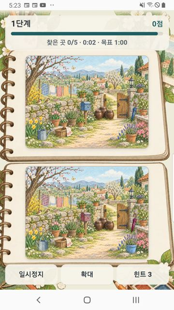

<b>브릭 스톰</b> — 한 손가락 조준·발사 벽돌깨기, 스토어판 86개 언어

- **왜**: AI로 게임을 반복 제작하는 흐름 검증과 스토어·앱인토스 수익화
- **역할**: 기획·요구사항·검수는 본인, 코드는 주로 AI
- 기술: TypeScript · Capacitor
- 웹: https://brick-storm.mycsbot.com/
- 스토어: [Google Play](https://play.google.com/store/apps/details?id=com.mycsbot.brickstorm)

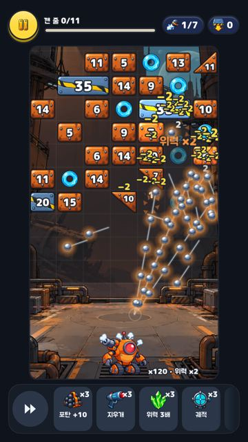
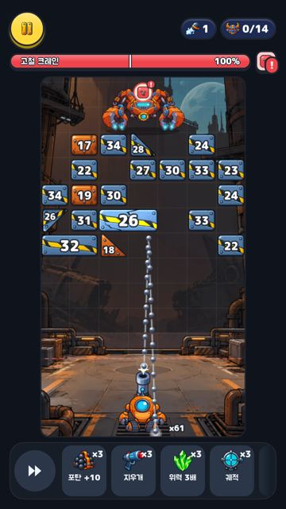

<b>사천성</b> — 꺾인 선 3번 규칙 짝맞추기, 단계마다 판 확장·경로 시각화

- **왜**: AI로 게임을 반복 제작하는 흐름 검증과 스토어·앱인토스 수익화
- **역할**: 기획·요구사항·검수는 본인, 코드는 주로 AI
- 기술: TypeScript
- 웹: https://sacheonseong.mycsbot.com/
- 스토어: [Google Play](https://play.google.com/store/apps/details?id=com.mycsbot.sacheonseong) · [App Store](https://apps.apple.com/kr/app/id6821350907)

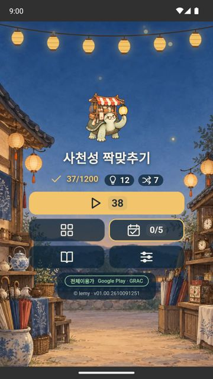
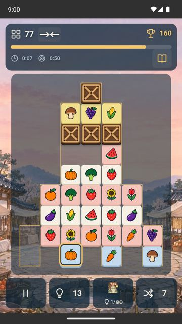

<b>보석 맞추기</b> — 1,200단계 매치3, 목표 7종을 단계 생성기로 생성

- **왜**: AI로 게임을 반복 제작하는 흐름 검증과 스토어·앱인토스 수익화
- **역할**: 기획·요구사항·검수는 본인, 코드는 주로 AI
- 기술: TypeScript
- 웹: https://jewel-match.mycsbot.com/
- 스토어: [Google Play](https://play.google.com/store/apps/details?id=com.mycsbot.jewelmatch)

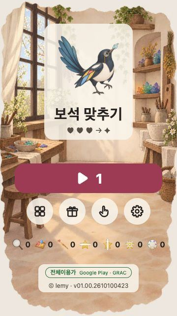
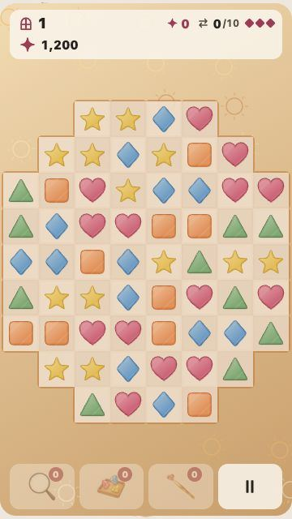

<b>폴짝 러너</b> — 원터치 러너

- **왜**: AI로 게임을 반복 제작하는 흐름 검증과 스토어·앱인토스 수익화
- **역할**: 기획·요구사항·검수는 본인, 코드는 주로 AI
- 기술: TypeScript
- 웹: https://hop-run.mycsbot.com/
- 스토어: [Google Play](https://play.google.com/store/apps/details?id=com.mycsbot.hoprun)

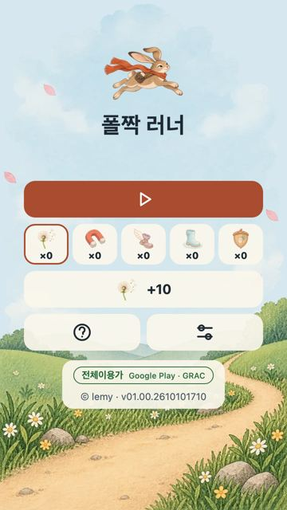
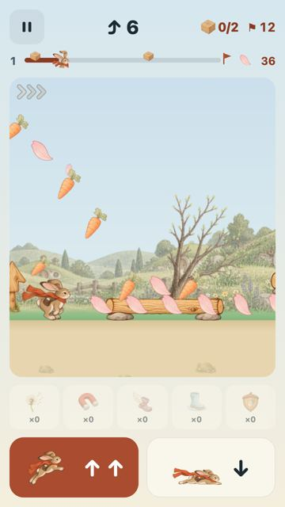

<b>왼쪽 오른쪽</b> — 봄나물은 밥상, 봄꽃은 꽃병으로 나누는 1분 좌우 나누기

- **왜**: AI로 게임을 반복 제작하는 흐름 검증과 스토어·앱인토스 수익화
- **역할**: 기획·요구사항·검수는 본인, 코드는 주로 AI
- 기술: TypeScript
- 웹: https://left-right.mycsbot.com/
- 스토어: [Google Play](https://play.google.com/store/apps/details?id=com.mycsbot.leftright)

<b>두더지 잡기</b> — 60초 아케이드

- **왜**: AI로 게임을 반복 제작하는 흐름 검증과 스토어·앱인토스 수익화
- **역할**: 기획·요구사항·검수는 본인, 코드는 주로 AI
- 기술: TypeScript
- 웹: https://mole-catch.mycsbot.com/
- 스토어: [Google Play](https://play.google.com/store/apps/details?id=com.mycsbot.molecatch)

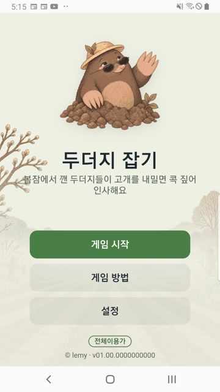
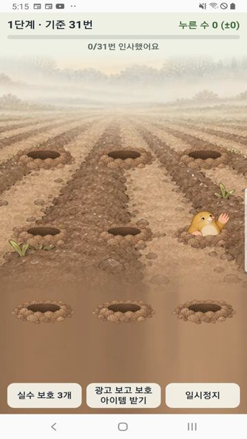

<b>카드 뒤집기</b> — 기억력 짝 맞추기

- **왜**: AI로 게임을 반복 제작하는 흐름 검증과 스토어·앱인토스 수익화
- **역할**: 기획·요구사항·검수는 본인, 코드는 주로 AI
- 기술: TypeScript
- 웹: https://card-flip.mycsbot.com/

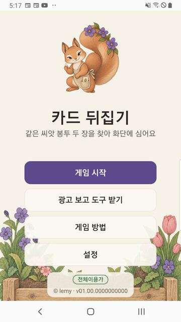
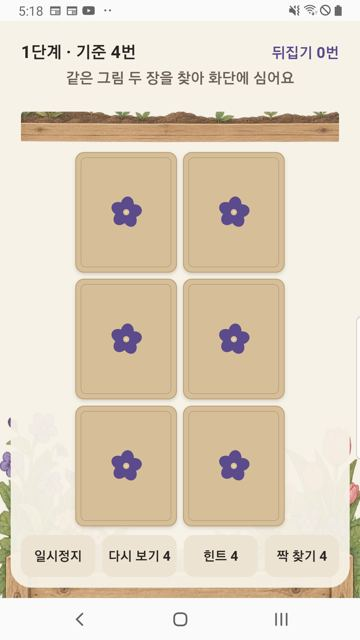

<b>워터 레스큐</b> — 관을 돌리고 옮겨 물길을 잇는 현장 출동 퍼즐

- **왜**: AI로 게임을 반복 제작하는 흐름 검증과 스토어·앱인토스 수익화
- **역할**: 기획·요구사항·검수는 본인, 코드는 주로 AI
- 기술: TypeScript
- 웹: https://water-rescue.mycsbot.com/

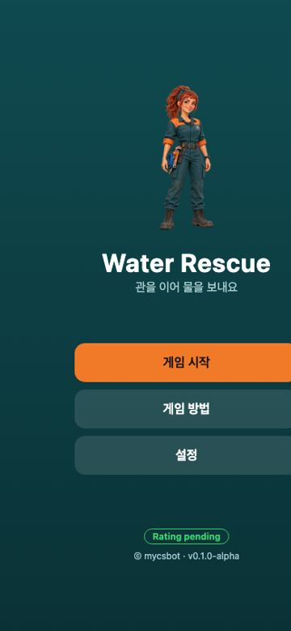

<b>Farm Rush</b> — 터치로 즐기는 오리지널 농장 경영 게임, 1,000 스테이지

- **왜**: AI로 게임을 반복 제작하는 흐름 검증과 스토어·앱인토스 수익화
- **역할**: 기획·요구사항·검수는 본인, 코드는 주로 AI
- 기술: JavaScript
- 웹: https://farm-rush.mycsbot.com/

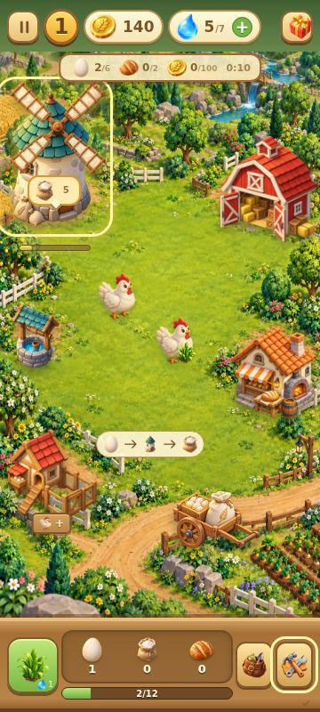
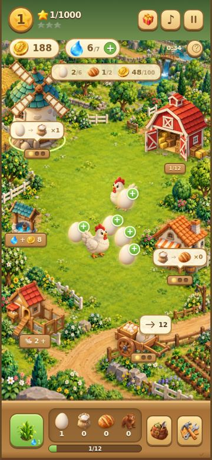

<b>Abyss Relay</b> — 전력을 배분하며 3분을 버티는 절차 생성 잠수함 생존 게임

- **왜**: AI로 게임을 반복 제작하는 흐름 검증과 스토어·앱인토스 수익화
- **역할**: 기획·요구사항·검수는 본인, 코드는 주로 AI
- 기술: TypeScript

<!-- projects:end -->

## 이전 경력

2001년 마이컴·모바일 게임 개발로 시작해 클라우드 모니터링·SDN 개발을 거쳐 Kubernetes 플랫폼 운영을 했습니다.

- **11번가** (2020.12~2025.07): Terraform 기반 EKS 구축·운영, Datadog → Prometheus·Grafana 전환을 EKS 12개에 적용, 대형 행사 전 용량 사전 확보
- **베스핀글로벌** (2019.11~2020.12): opsnow.com Kubernetes·EKS 운영, 신규 서비스 CI/CD
- **에스코어** (2012.04~2019.10): 클라우드 모니터링 에이전트, OpenStack Neutron·SDN, 관리 콘솔

## 기술 스택

- **Frontend**: TypeScript, React, Next.js, Vite, Flutter/Dart
- **Backend**: Python, FastAPI, SQLAlchemy, PostgreSQL
- **Infra**: Docker Compose, Cloudflare (Pages·Tunnel), AWS Lightsail, Terraform, GitHub Actions, Prometheus/Grafana
- **AI**: MCP 서버, OAuth, AI 이미지 파이프라인, LLM 에이전트 워크플로

## GitHub 활동

연도별 기여 수(비공개 저장소 포함): 2023 521 · 2024 172 · 2025 1,110 · 2026 3,802 (10월 15일 기준)
